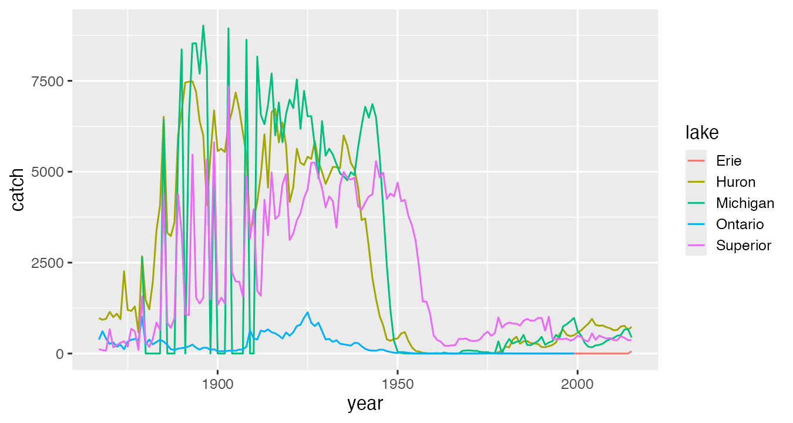
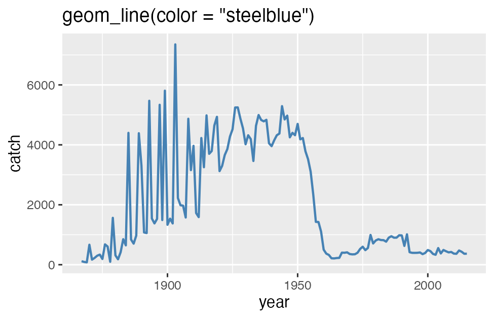
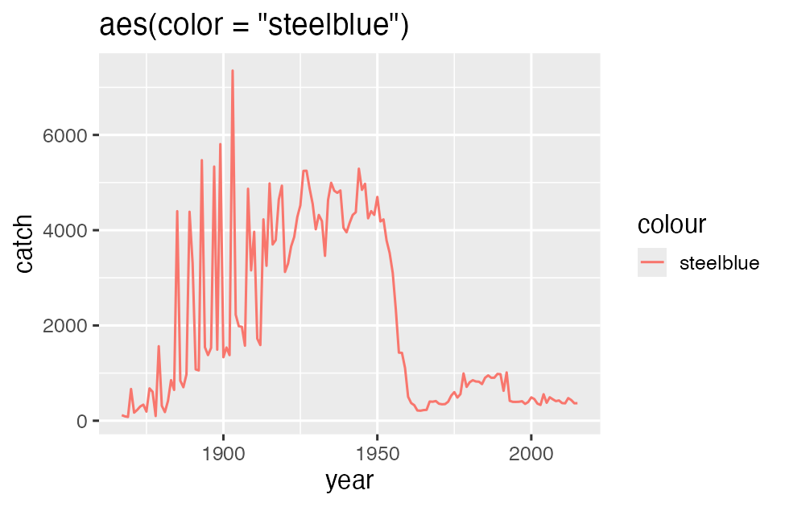
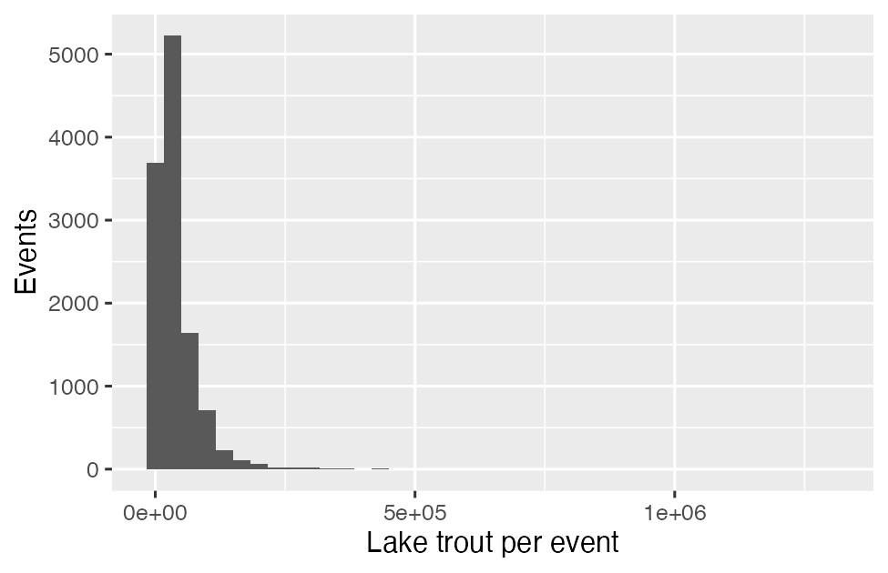
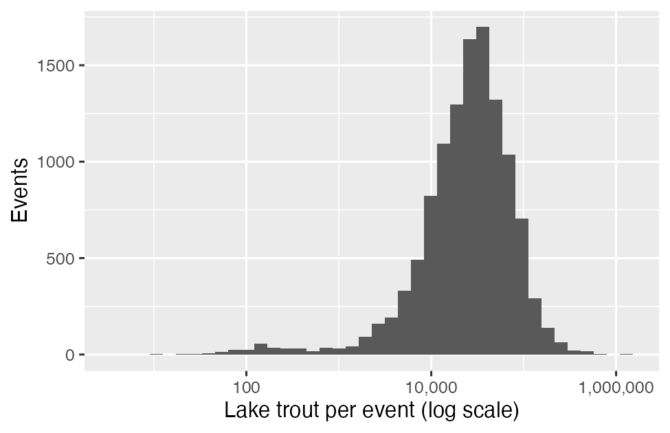
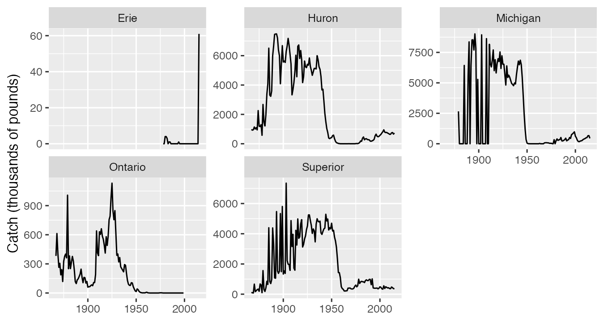
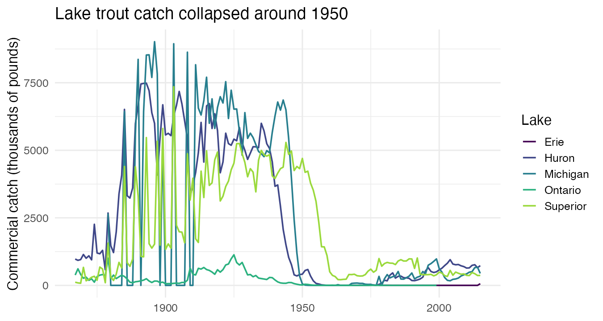
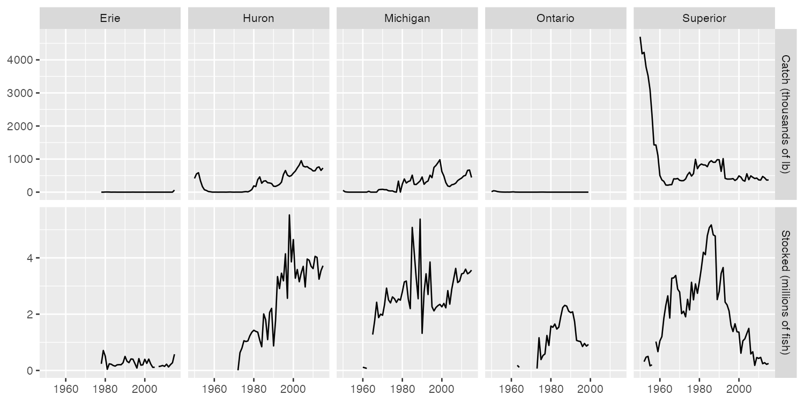

```{r}
#| include: false
library(gt)
library(countdown)

# One table style for every slide table (instructor convention: gt tables).
slide_table <- function(df) {
  gt(df) |>
    fmt_markdown(columns = everything()) |>
    tab_options(
      table.font.size = px(24),
      column_labels.font.weight = "bold",
      table.width = pct(100),
      data_row.padding = px(6)
    ) |>
    opt_row_striping()
}
```

## Slide Accessibility Note
- **Images:** every figure has alt text; diagrams are HTML text with labels.
- **Speaker Notes:** These slides follow the Module 08 follow-along script
  and the book chapter Visualizing Wrangled Data. The live coding happens
  in `class/week_08_follow_along.R`.

## Today

::: {.diagram-flow .diagram-compact aria-label="Today's workflow: a table you cleaned and checked, then ggplot with aes, then a geom chosen by data type, then facets, scales, labels and palette, then a caption that states the pattern. After the break: joining two tables"}
<div class="diagram-node">Cleaned, checked table</div>
<div class="diagram-arrow" aria-hidden="true">-&gt;</div>
<div class="diagram-node"><code>ggplot(aes())</code></div>
<div class="diagram-arrow" aria-hidden="true">-&gt;</div>
<div class="diagram-node">Geom by data type</div>
<div class="diagram-arrow" aria-hidden="true">-&gt;</div>
<div class="diagram-node">Facets, scales, labels</div>
<div class="diagram-arrow" aria-hidden="true">-&gt;</div>
<div class="diagram-node">Caption states the pattern</div>
:::

<p class="diagram-caption">After the break: joining two tables, then one figure in your project report.</p>

- **Proposal due Sun Nov 15**, 11:59 PM
- **Draft due Sun Nov 29:** needs **3 figures**. Today is practice for them.

## Get Today's Files: Pull

I added two files to your **Module 05** repo on GitHub:
`class/week_08_follow_along.R` and `class/data/stocked.csv`.

:::: {.columns}
::: {.column width="50%"}
**GitHub Desktop**

1. Commit anything changed
2. **Fetch origin**
3. **Pull origin**
:::
::: {.column width="50%"}
**Positron**

1. Missed Oct 26? Once, in the Terminal:<br>`git config --global pull.rebase false`
2. Source Control: commit anything changed
3. **...** menu > **Pull**
:::
::::

```{r}
#| echo: false
countdown(minutes = 3)
```

## Stuck On The Pull?

```{r}
#| echo: false
tibble::tribble(
  ~`You see`, ~`Do this`,
  "Positron: \"reconcile **divergent branches**\"", "Terminal: `git pull --no-rebase --no-edit`, then push",
  "No Pull option / \"not a git repository\"", "Open the Module 05 repo folder",
  "Anything else after 3 minutes", "Download both files below into `class/` and `class/data/`"
) |>
  slide_table()
```

<a class="script-download" href="../scripts/week_08_follow_along.R" download style="background-color: #d00000 !important; color: #fff !important;">Download the Module 08 follow-along script (.R)</a>

[Download stocked.csv from TidyTuesday (7.3 MB)](https://raw.githubusercontent.com/rfordatascience/tidytuesday/main/data/2021/2021-06-08/stocked.csv)

## Setup Check

1. **Session > Restart R**
2. Open `class/week_08_follow_along.R`, run Section 0
3. `dim(fishing)` **65706 7** and `dim(stocked)` **56232 31**

## Learning Goals

- Build a plot from its three parts: **data, aesthetics, geom**
- Tell an **aesthetic** (mapped from a column) from a **setting** (one
  fixed value)
- Pick a geom by **data type**; use **facets**, **log scales**, **units**,
  and a **colorblind-safe** palette
- Join two tables by a **key**, and **audit** the join with row counts and
  `anti_join()`
- Put a figure with `fig-cap` and `fig-alt` in your project report

## The Data: Great Lakes, Again

```{r}
#| echo: false
tibble::tribble(
  ~File, ~`One row is`, ~Units, ~`You met it in`,
  "`fishing.csv`", "lake, year, species, region", "catch, **thousands of pounds**", "Module 05",
  "`stocked.csv`", "one stocking event", "number of fish", "Module 04"
) |>
  slide_table()
```

Both from the Great Lakes Fishery Commission, via TidyTuesday 2021-06-08.

**Story for today:** lake trout collapsed around 1950. Managers started
stocking. Did catch come back?

## Recap: Build The Table First

Module 05 trap: **total rows** sit on top of area rows.

```r
lake_catch <- fishing |>
  mutate(region = str_trim(region)) |>
  filter(region %in% lake_totals) |>      # U.S. + Canada total rows only
  group_by(lake, year, species) |>
  summarize(catch = sum(values, na.rm = TRUE), .groups = "drop")
```

**CHECK:** `nrow(lake_catch)` **12047**; `trout` has **606** rows.

::: {.notes}
Whole-lake = U.S. total + Canada total. Agrees with the file's grand_total in 99.9% of lake-years that have one (Lake Michigan has none). One region has a trailing space, so str_trim().
:::

## Three Parts, Every Plot

```r
ggplot(trout, aes(x = year, y = catch, color = lake)) +
  geom_line()
```

```{r}
#| echo: false
tibble::tribble(
  ~Part, ~`In this code`, ~`What it decides`,
  "**Data**", "`trout`", "a tidy table you already checked",
  "**Aesthetics**", "`aes(x = year, y = catch, color = lake)`", "which **column** goes to which visual property",
  "**Geom**", "`geom_line()`", "what shape draws it"
) |>
  slide_table()
```

Layers join with **`+`**, not `|>`.

## What Happened Around 1950?

{fig-alt="Line chart of commercial lake trout catch by year, 1867 to 2015, one colored line per lake. Michigan, Huron and Superior lines are high until the 1940s; Michigan and Huron fall to near zero by 1955 and Superior falls in the late 1950s." height=480}

::: {.notes}
Sea lamprey plus overfishing. Michigan 6,266 thousand lb in 1940, 0 in 1955. Superior held on a decade longer.
:::

## Aesthetic Or Setting?

:::: {.columns}
::: {.column width="50%"}
{fig-alt="Lake Superior lake trout catch drawn as a thick steel blue line with no legend." width=100%}

**Setting**, outside `aes()`: one fixed value.
:::
::: {.column width="50%"}
{fig-alt="The same Lake Superior line drawn in salmon pink, with a legend titled colour that has one entry reading steelblue." width=100%}

Inside `aes()`: R **maps** a fake column whose every value is the word
"steelblue".
:::
::::

## Labels With Units

```r
labs(
  x = NULL,
  y = "Commercial catch (thousands of pounds)",
  color = "Lake",
  title = "Lake trout catch collapsed around 1950"
)
```

- The project rubric checks **units on every axis**
- A title that **states the finding** beats "Lake trout by year"

## Challenge 1 (15 min)

- **Step 1 (everyone):** lake whitefish catch over time, one line per
  lake, y label with units. Which lake led in **2015**? **CHECK: Huron,
  3444**
- **Step 2 (Step 1 matches):** Lake Michigan whitefish only, one fixed line
  color, thicker line. Setting or aesthetic?

```{r}
#| echo: false
countdown(minutes = 15)
```

## Challenge 1: Hint 1, The Plan {.smaller}

:::: {.columns}
::: {.column width="50%"}
**Step 1**

1. Start from `lake_catch`, not `trout`
2. `filter()` the species: `"Lake Whitefish"`
3. Pipe into the same `ggplot()` + `geom_line()` + `labs()`
4. For the CHECK: `filter(year == 2015)`, `arrange(desc(catch))`
:::
::: {.column width="50%"}
**Step 2**

1. Add `lake == "Michigan"` to the same `filter()`
2. Remove `color = lake` from `aes()`
3. Put `color = "..."` and `linewidth = 1` **inside** `geom_line()`
:::
::::

Still stuck? **Hint 2** is in the book: [Visualizing Wrangled Data, In-Class Challenge Hints](https://nres800-fall2026.netlify.app/chapters/08-visualizing-wrangled-data.html#in-class-challenge-hints) (book chapter 11).

## Pick The Geom By The Data

```{r}
#| echo: false
tibble::tribble(
  ~`Your data`, ~Geom, ~`Today's example`,
  "a number over time", "`geom_line()`", "catch by year",
  "one number per category", "`geom_col()`", "total catch by lake",
  "distribution of one number", "`geom_histogram()`, `geom_boxplot()`", "fish per stocking event",
  "two numbers", "`geom_point()`", "stocked vs caught (try at home)"
) |>
  slide_table()
```

`geom_col()` plots a number you already have. `geom_bar()` **counts rows**
for you.

## Where Is Lake Ontario?

```r
trout |> filter(year >= 2000) |> group_by(lake) |>
  summarize(total = sum(catch)) |>
  ggplot(aes(x = lake, y = total)) + geom_col()
```

. . .

**Four bars.** Ontario's catch rows **end in 1999**.

A missing bar is not a zero bar. **Say so in the caption.**

## Scales: When Everything Piles Up

:::: {.columns}
::: {.column width="50%"}
{fig-alt="Histogram of lake trout per stocking event on a regular axis. Nearly all events are in the first bar at the far left; the axis runs to 1.3 million." width=100%}

Median **27,167** fish, max **1,300,000**
:::
::: {.column width="50%"}
{fig-alt="The same histogram with a log-scale x axis. Events spread into a hump centered near 20,000 to 50,000 fish." width=100%}

`scale_x_log10()`. log cannot show 0: drop zeros (**1** event) and say so.
:::
::::

## Facets: One Panel Per Group

{fig-alt="Five small line charts of lake trout catch, one per lake, each with its own y axis range." height=420}

`facet_wrap(~ lake, scales = "free_y")`. With **free_y**, panel heights are
not comparable: **say so in the caption**.

## Color Everyone Can Read

{fig-alt="Lake trout catch by year, one line per lake in viridis colors from dark purple to green, with labeled axes in thousands of pounds and the title Lake trout catch collapsed around 1950." height=400}

`scale_color_viridis_d(end = 0.85)`: colorblind-safe, no pale yellow.
Color should **never be the only way** to read a plot: facets or labels
back it up.

## Challenge 2 (15 min)

- **Step 1 (everyone):** boxplot of lake trout per stocking event
  (`species == "LAT"`), one box per lake, log y axis, zeros removed. Largest
  median? **CHECK: MI, 50400**
- **Step 2 (Step 1 matches, or at home):** lake trout stocked per year in
  **millions**, bars, one panel per lake. Biggest lake-year?

```{r}
#| echo: false
countdown(minutes = 15)
```

## Challenge 2: Hint 1, The Plan {.smaller}

:::: {.columns}
::: {.column width="50%"}
**Step 1**

1. `stocked`, `filter()` species **and** `no_stocked > 0`
2. `aes(x = lake, y = no_stocked)`, `geom_boxplot()`
3. Log scale on **y**: `scale_y_log10()`
4. CHECK: `group_by(lake)`, `summarize(median(no_stocked))`
:::
::: {.column width="50%"}
**Step 2**

1. `group_by(lake, year)`, `summarize(sum(no_stocked) / 1e6)`
2. One number per category: which geom?
3. `facet_wrap(~ lake)`
:::
::::

Still stuck? **Hint 2** is in the book: [Visualizing Wrangled Data, In-Class Challenge Hints](https://nres800-fall2026.netlify.app/chapters/08-visualizing-wrangled-data.html#in-class-challenge-hints) (book chapter 11).

## Break (10 min)

```{r}
#| echo: false
countdown(minutes = 10)
```

## Joins: Two Tables, One Key

Catch is in `fishing`. Stocking is in `stocked`. To plot them together,
match rows by a **key**.

```{r}
#| echo: false
tibble::tribble(
  ~Verb, ~`Returns`, ~`Use it to`,
  "`left_join(x, y, by =)`", "every row of `x`, plus matching columns of `y` (NA if none)", "add columns",
  "`anti_join(x, y, by =)`", "rows of `x` with **no** match in `y`", "**audit** the join"
) |>
  slide_table()
```

**Before and after every join:** `nrow()`.

## The Keys Do Not Match

Catch says `"Michigan"`. Stocking says `"MI"`. Fix with a lookup table:

```r
lake_key <- tibble(
  lake_code = c("ER", "HU", "MI", "ON", "SU"),
  lake      = c("Erie", "Huron", "Michigan", "Ontario", "Superior")
)
stock_trout <- stock_trout |> left_join(lake_key, by = "lake_code")
```

**CHECK:** 264 rows before, **264 after**. A lookup join never adds rows.

## Join Catch And Stocking

```r
trout_both <- trout |>
  left_join(stock_trout, by = c("lake", "year"))
```

**CHECK:** 606 rows, same as `trout`.

. . .

```r
trout |> anti_join(stock_trout, by = c("lake", "year")) |> count(lake)
```

**378** catch years with no stocking record (Huron **105**). Catch starts in
1867; stocking records start 1950-1972. **NA = no record, not zero fish.**

## The Trap: A Key That Is Too Short

```r
trout |> left_join(stock_trout, by = "lake") |> nrow()
```

. . .

**32,877 rows** and a warning: *Detected an unexpected many-to-many
relationship*.

Every catch year matched **every** stocking year for that lake. The row
count is how you catch it.

## Did Catch Come Back?

{fig-alt="Grid of line charts, 1950 to 2015. Top row: lake trout catch in thousands of pounds for each of five lakes. Bottom row: lake trout stocked in millions. Huron and Michigan catch rises after stocking climbs in the 1970s and 1980s. Superior catch drops in the late 1950s, then holds while stocking falls after 2000." height=430}

`pivot_longer()` (Module 06) + `facet_grid(measure ~ lake, scales = "free_y")`

## Your Project: One Figure Today (10 min)

In your **project** repo, `report.qmd`:

```{{r}}
#| label: fig-trout
#| fig-cap: "Lake trout catch fell to near zero in Lakes Michigan and Huron by 1955."
#| fig-alt: "Line chart of lake trout catch by lake, 1867-2015."
ggplot(trout, aes(x = year, y = catch, color = lake)) + geom_line()
```

- `fig-cap` = the **pattern** (the rubric checks this). `fig-alt` = what it
  shows, for a screen reader.
- Label starts with **`fig-`**: Quarto numbers it; refer to it as `@fig-trout`

```{r}
#| echo: false
countdown(minutes = 10)
```

## What Is Next

- **Proposal due Sun Nov 15**, 11:59 PM (rendered, pushed)
- **Assignment 08:** NOAA tornadoes, plots and a join. Opens this week, **due
  Sun Nov 22**
- **Draft due Sun Nov 29:** `report.qmd`, every section started, 3 figures

::: {.notes}
Confirm the Assignment 08 release date before saying it out loud.
:::

## Before You Leave

- [ ] Follow-along runs top to bottom after restarting R
- [ ] **Commit and push `class/`** in your **Module 05** repo
- [ ] One figure of **your own data** in your project `report.qmd`, pushed
