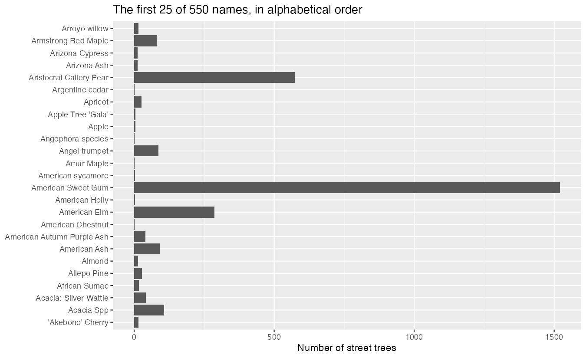
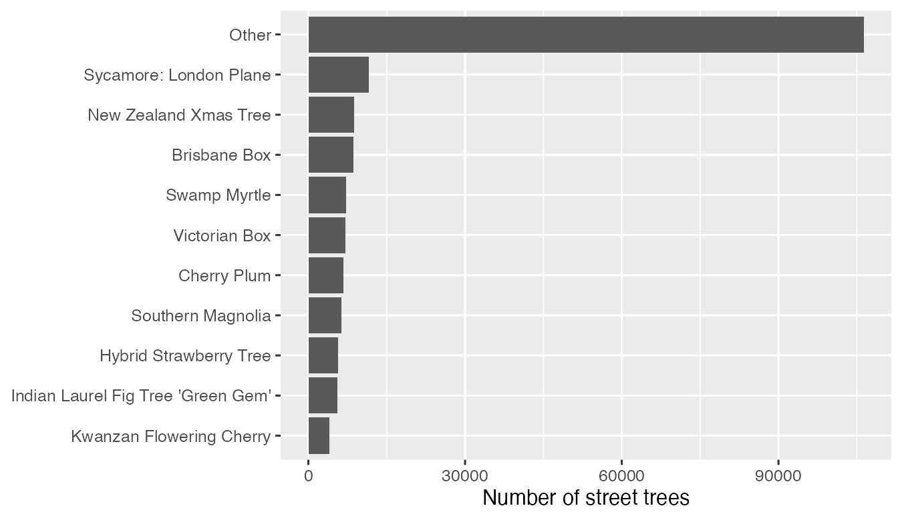
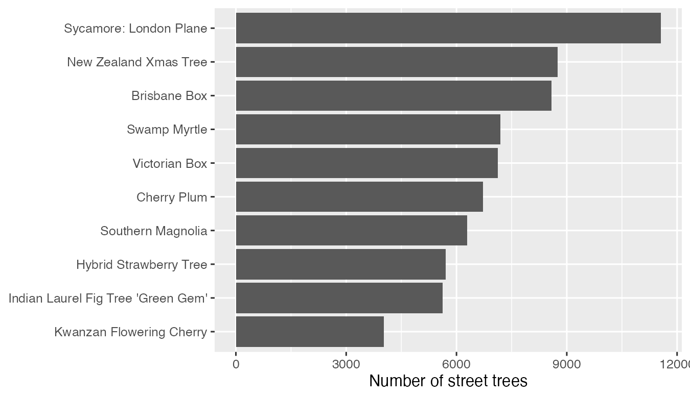
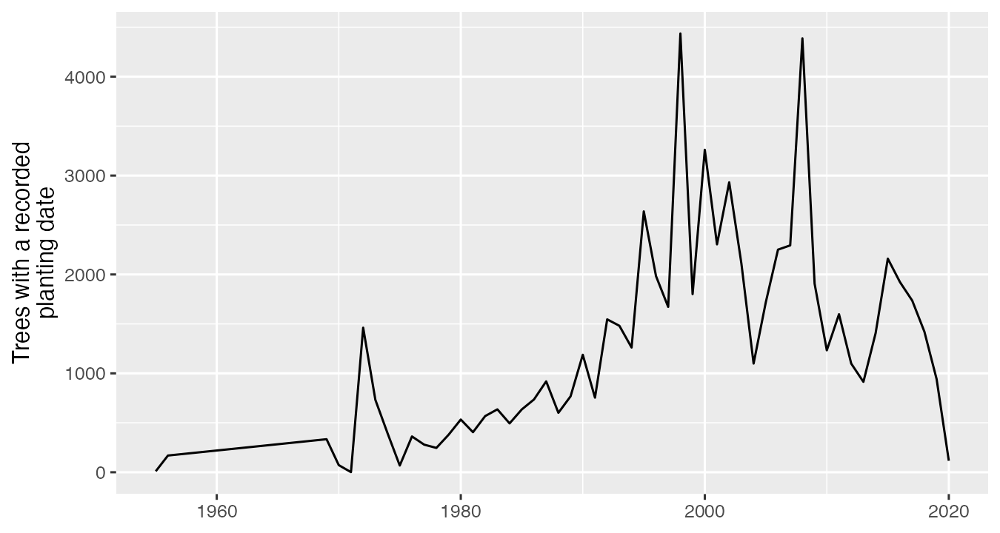
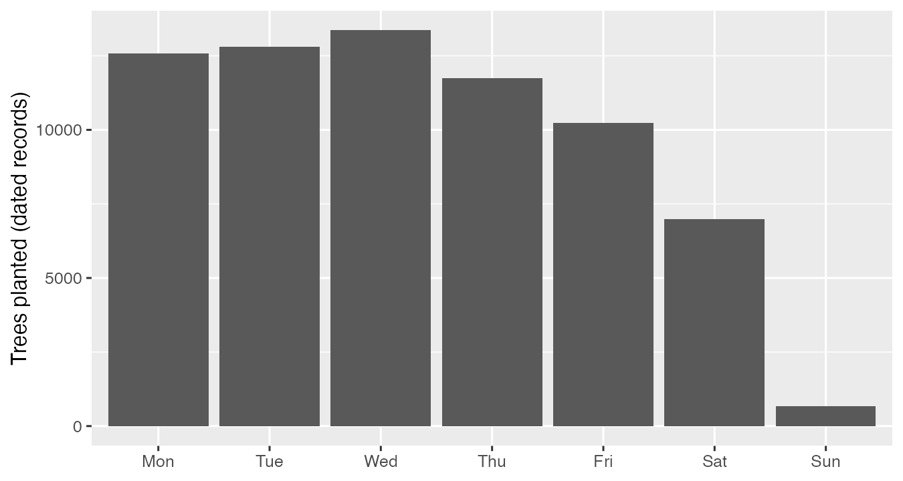

```{r}
#| include: false
library(gt)
library(countdown)

# One table style for every slide table (instructor convention: gt tables).
slide_table <- function(df) {
  gt(df) |>
    fmt_markdown(columns = everything()) |>
    tab_options(
      table.font.size = px(24),
      column_labels.font.weight = "bold",
      table.width = pct(100),
      data_row.padding = px(6)
    ) |>
    opt_row_striping()
}

# Project timeline table, shared by every deck; pass this class's date.
source("../R/project_timeline.R")
```

## Slide Accessibility Note
- **Images:** every figure has alt text; diagrams are HTML text with labels.
- **Speaker Notes:** These slides follow the Module 09 follow-along script
  and the book chapter Text, Categories, and Dates. The live coding happens
  in `class/week_09_follow_along.R`.

## Today

::: {.diagram-flow aria-label="Today's workflow: text columns get split, trimmed and placeholders made NA with stringr; category columns get their levels chosen and ordered with forcats; date columns get the needed part pulled out with lubridate; then one table and one inline value in your own report"}
<div class="diagram-node">Text: split, trim, NA</div>
<div class="diagram-arrow" aria-hidden="true">-&gt;</div>
<div class="diagram-node">Categories: choose, order</div>
<div class="diagram-arrow" aria-hidden="true">-&gt;</div>
<div class="diagram-node">Dates: pull out a part</div>
<div class="diagram-arrow" aria-hidden="true">-&gt;</div>
<div class="diagram-node">Your report: a table, a number</div>
:::

<p class="diagram-caption">A short module: the last 40 minutes are your project draft.</p>

- **No Assignment 09.** Assignment 08 due **Sun Nov 22**
- **Draft due Sun Nov 29.** Nov 23 is a project workshop

## Your Project: Where We Are {.smaller}

```{r}
#| echo: false
project_timeline("2026-11-16")
```

## Get Today's Files: Pull

I added two files to your **Module 05** repo on GitHub:
`class/week_09_follow_along.R` and `class/data/sf_trees.csv` (31 MB).

:::: {.columns}
::: {.column width="50%"}
**GitHub Desktop**

1. Commit anything changed
2. **Fetch origin**
3. **Pull origin**
:::
::: {.column width="50%"}
**Positron**

1. Source Control: commit anything changed
2. **...** menu > **Pull**
:::
::::

```{r}
#| echo: false
countdown(minutes = 3)
```

## Stuck On The Pull?

```{r}
#| echo: false
tibble::tribble(
  ~`You see`, ~`Do this`,
  "Positron: \"reconcile **divergent branches**\"", "Terminal: `git pull --no-rebase --no-edit`, then push",
  "No Pull option / \"not a git repository\"", "Open the Module 05 repo folder",
  "Anything else after 3 minutes", "Download both files below into `class/` and `class/data/`"
) |>
  slide_table()
```

<a class="script-download" href="../scripts/week_09_follow_along.R" download style="background-color: #d00000 !important; color: #fff !important;">Download the Module 09 follow-along script (.R)</a>

[Download sf_trees.csv from TidyTuesday (31 MB)](https://raw.githubusercontent.com/rfordatascience/tidytuesday/main/data/2020/2020-01-28/sf_trees.csv)

## Setup Check

1. **Session > Restart R**
2. Open `class/week_09_follow_along.R`, run Section 0
3. `dim(trees)` **192987 12**

## Learning Goals

- **Split** a text column that holds two facts, **trim** it, and turn
  placeholder text into `NA`
- Make values that mean the same thing **match** (`str_to_lower()`)
- **Choose** and **order** category levels for a plot (`fct_lump_n()`,
  `fct_infreq()`), and say so in the caption
- Pull the **part of a date** a question needs (`year()`, `wday()`)
- Put a **`gt` table** and an **inline value** in your project report

## The Data: San Francisco Street Trees

```{r}
#| echo: false
tibble::tribble(
  ~Column, ~`What it holds`, ~`The decision`,
  "`species`", "`\"Platanus x hispanica :: Sycamore: London Plane\"`", "split into two columns",
  "`plot_size`", "`\"Width 3ft\"`, `\"3x3\"`, `\"3X3\"` (525 versions)", "match the spelling",
  "`caretaker`", "22 groups, one with 162,000 trees", "lump the small ones",
  "`date`", "planting date; **65% missing**", "say what the dates cover"
) |>
  slide_table()
```

192,987 trees, the city's public inventory, via TidyTuesday 2020-01-28.

## The Most Common "Species"

```{r}
#| echo: false
tibble::tribble(
  ~species, ~n,
  "`Tree(s) ::`", "11,629",
  "`Platanus x hispanica :: Sycamore: London Plane`", "11,557",
  "`Metrosideros excelsa :: New Zealand Xmas Tree`", "8,744"
) |>
  slide_table()
```

**Is `Tree(s)` a species?** The inventory did not record one. It is text,
so R counts it like any other name until you make it `NA`.

## One Column, Two Facts

```r
trees_sp <- trees |>
  separate_wider_delim(species, delim = "::",
                       names = c("scientific", "common"),
                       too_few = "align_start") |>       # rows with no "::"
  mutate(across(c(scientific, common), str_trim),        # spaces left over
         across(c(scientific, common), \(x) na_if(x, "")),
         scientific = na_if(scientific, "Tree(s)"))      # placeholder -> NA
```

**CHECK:** `no_scientific` **13468**, `no_common` **15086**

::: {.notes}
13,468 = 11,629 "Tree(s) ::" + 1,839 "::". Another 1,618 have a scientific name and no common name ("Tristania conferta ::"). Split on "::" without spaces: "Tree(s) ::" has no space after the colons, so " :: " would not split it.
:::

## Same Thing, Different Spelling

`plot_size` has **525** distinct values. Lowercase first:

```r
n_distinct(str_to_lower(trees$plot_size))   # 465
```

Then pull the number out of the `"width ..."` rows:

```r
width_ft = if_else(str_detect(plot_size, "^width"),
                   as.numeric(str_extract(plot_size, "[0-9.]+")), NA)
```

**CHECK:** `has_width` **85694**, `width_zero` **17017**. What does
"Width 0ft" mean for a tree?

## Challenge 1 (10 min)

- **Step 1:** the five most common trees by **common name**, unknowns
  removed. **CHECK: London Plane 11557 first, Victorian Box 7122 fifth**
- **Step 2:** how many trees have **"Cherry"** anywhere in the common
  name? **CHECK: 14571**

```{r}
#| echo: false
countdown(minutes = 10)
```

## Challenge 1: Hint 1, The Plan {.smaller}

:::: {.columns}
::: {.column width="50%"}
**Step 1**

1. Start from `trees_sp`
2. `filter(!is.na(common))`
3. `count(common, sort = TRUE)`
4. `head(5)`
:::
::: {.column width="50%"}
**Step 2**

1. Start from `trees_sp`
2. `filter(str_detect(common, "Cherry"))`
3. `nrow()`
4. Why more than "Cherry Plum" alone? `str_detect()` matches **anywhere**
:::
::::

Still stuck? **Hint 2** is in the book: [Text, Categories, and Dates, In-Class Challenge Hints](https://nres800-fall2026.netlify.app/chapters/09-text-categories-dates.html#in-class-challenge-hints).

## 550 Names Make 550 Bars

{fig-alt="Horizontal bar chart of the first 25 common tree names in alphabetical order. Bar lengths jump around with no pattern, from almost zero to about 1,500 trees." height=460}

Alphabetical order answers no question.

## Choose The Levels, Then Order Them

:::: {.columns}
::: {.column width="50%"}
{fig-alt="Bar chart of the 10 most common trees plus an Other bar. Other, about 106,000 trees, is far longer than any named tree; London Plane is second at about 11,600." width=100%}
:::
::: {.column width="50%"}
{fig-alt="Bar chart of the 10 most common street trees with Other removed, biggest on top: London Plane, New Zealand Xmas Tree, Brisbane Box, and so on down to Kwanzan Flowering Cherry." width=100%}
:::
::::

`fct_lump_n(common, n = 10)`, then `fct_rev(fct_infreq(common))`.
**Other is 60%** of named trees: keep it and explain it, or drop it and say
"the 10 most common".

## Challenge 2 (10 min)

Who looks after the trees? **Lump `caretaker` to the top 3 plus Other**,
bars ordered by count, biggest on top.

**CHECK:** Private, DPW, **Other**, SFUSD. Why is Other third?

```{r}
#| echo: false
countdown(minutes = 10)
```

## Challenge 2: Hint 1, The Plan {.smaller}

1. Start from `trees` (caretaker needs no cleaning)
2. `mutate(caretaker = fct_lump_n(caretaker, n = 3))`
3. `ggplot(aes(y = fct_rev(fct_infreq(caretaker)))) + geom_bar()`
4. Other is 19 small groups together, so it outranks SFUSD. To force it
   last: `fct_relevel(caretaker, "Other", after = Inf)` after
   `fct_infreq()`

## Break (10 min)

```{r}
#| echo: false
countdown(minutes = 10)
```

## Dates: Pull Out The Part You Need

**124,610** trees (65%) have **no** planting date.

{fig-alt="Line chart of trees with a recorded planting date per year, 1955 to 2020. Few before 1980, rising to peaks of about 4,400 in 1998 and 2008, then falling after 2016." height=360}

This figure describes **dated records**. Is the drop after 2016 fewer
trees, or records not yet entered?

## Which Day?

```r
planted <- trees |>
  filter(!is.na(date)) |>
  mutate(year = year(date),
         weekday = wday(date, label = TRUE, week_start = 1))  # A08 again
```

{fig-alt="Bar chart of trees planted by day of the week. Monday to Thursday each about 12,000 to 13,000, Friday about 10,000, Saturday about 7,000, Sunday under 1,000." height=330}

**Sat 10.2%, Sun 1.0%.** What would you check before saying so in a report?

## Your Report: One Table, One Number (20 min) {.smaller}

:::: {.columns}
::: {.column width="55%"}
**A table** (a chunk in `report.qmd`)

```r
#| label: tbl-top-trees
#| tbl-cap: "The five most common street trees."
top5 |>
  gt() |>
  cols_label(common = "Common name",
             n = "Street trees") |>
  fmt_number(columns = n, decimals = 0)
```
:::
::: {.column width="45%"}
**A number in a sentence** (in the text, not a chunk)

```{r}
#| echo: false
#| comment: ""
cat("The city lists",
    knitr::inline_expr('format(nrow(trees), big.mark = ",")'),
    "\nstreet trees.")
```

Renders as: The city lists 192,987 street trees.

A typed number goes stale. An inline value is recomputed every render.
:::
::::

`library(gt)` fails? `install.packages("gt")`.

```{r}
#| echo: false
countdown(minutes = 20)
```

## Draft Work Time (20 min)

- `report.qmd` renders after **Restart R**?
- **3 figures**, each with `fig-cap` and `fig-alt`?
- Every section started?

Ask me now. Nov 23 is a full workshop.

```{r}
#| echo: false
countdown(minutes = 20)
```

## What Is Next

- **Assignment 08** due **Sun Nov 22**, 11:59 PM
- **Mon Nov 23:** project workshop. Bring your draft and your questions
- **Draft due Sun Nov 29:** `report.qmd` renders, every section started,
  3 figures

## Before You Leave

- [ ] Follow-along runs top to bottom after restarting R
- [ ] **Commit and push `class/`** in your **Module 05** repo
- [ ] One `gt` table and one inline value in your project `report.qmd`,
  pushed
